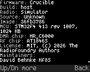
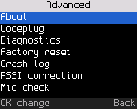

<!-- SPDX-License-Identifier: MIT -->

# Settings

Open Settings with **OK**, **7**, or with **\***, **0**. Settings are grouped by what they are for. A number key opens
a group directly. Find also reaches each setting by name: type its first letters on Home.

## Changing a setting

Each row shows its current value.

- On/off and list settings change with **OK**: each press goes to the next value.
- Number settings open an editor on **OK**. Change the value with **Up** and **Down** (or the channel knob), or type
  it with the number keys, press **OK** to keep it, **Back** to leave it unchanged. A typed value outside the range,
  or between steps, isn't taken: the radio says "Not changed" with the range.
- A setting takes effect and is saved as soon as you change it. There is no separate save step.

Some settings are on the menu before the feature behind them exists, or don't apply to this radio. They are dimmed.
**OK** on a dimmed row says why. The Status column of each table shows this:

| Status | Meaning |
|---|---|
| Works | Acts now and is kept across power off |
| Works, not kept | Acts now, back to the default after power off |
| Dimmed | Not built yet, or not on this radio. **OK** says why |

## Reference

### Sound (key 1)

| Setting | Values | Default | What it does | Status |
|---|---|---|---|---|
| Key tones | On, Off | On | A short beep on each key press | Works |
| Volume | 0 to 16 | 8 | The speaker volume, on radios without a volume knob only (the row is not shown on the others). 0 is mute. The **Volume** key opens a screen that changes it faster ([Radio reference](23-radios.md#key-roles)) | Works |
| Tone volume | 0 to 10 | 5 | The loudest the radio's beeps get. Beeps follow the speaker volume up to this level, so turning the volume down makes them quieter too. On some radios beeps stop getting louder above volume step 7, so voice can be turned up without louder beeps | Works |
| Talk permit tone | On, Off | On | The beep when a DMR transmission starts ([DMR](09-dmr.md)) | Works |
| Call end tone | On, Off | On | The two-note beep when a DMR call you heard ends | Works |
| TOT warning tone | On, Off | On | The beep a few seconds before the transmit time-out cuts a transmission | Works |
| Battery tone | On, Off | On | The beeps for a low and a critical battery | Works |
| TX denied tone | On, Off | On | The low tone when the radio refuses PTT or the time-out cuts a transmission | Works |
| Scan stop tone | On, Off | Off | A short beep when a scan stops on a signal | Works |
| Emergency tone | On, Off | On | The warble when the radio hears someone's emergency. Dimmed in a build without DMR emergency | Works |
| Voice prompts | On, Off | Off | Spoken prompts. There is no recorded speech yet | Dimmed |
| Message tone | On, Off | On | A three-note tone when a text message arrives | Works |
| Vibrate | On, Off | On | The radio vibrates for a text message, a call alert, a private call to you and an emergency it hears. Only on radios with a vibration motor ([Radio reference](23-radios.md)) | Works |

### Display (key 2)

| Setting | Values | Default | What it does | Status |
|---|---|---|---|---|
| Brightness | 10 to 100 %, steps of 10 | 100 % | Backlight brightness. Also in quick settings, tile 9 | Works |
| Backlight Dim/Off | 5s/20s, 10s/40s, 30s/2m, 1m/4m, 2m/8m, 10s/dim, 30s/dim, 1m/dim, 2m/dim, Never | 30s/2m | Without a key press, the backlight dims to a fifth after the first time and goes off after the second. The "dim" choices dim and never go off | Works |
| Theme | Dark, Light, High contrast, Night (red) | Dark | The screen colors. Night (red) uses only shades of red on black, so your eyes stay adapted to the dark; RX, TX and warnings differ by brightness and their word, not color. The power-on screen keeps its own colors. Not on radios with a monochrome screen | Works |
| Highlight color | Default, Red, Orange, Yellow, Teal, Light blue, Purple, Pink | Default | The color of the selected row or tile and of the channel number on Home. Not in the Night theme, which is always red. Not on radios with a monochrome screen | Works |
| Filled status bar | On, Off | On | Fills the top status line with the highlight color (light gray with Default, white in the high-contrast theme, bright red in Night) and draws its text black. Not on radios with a monochrome screen | Works |
| Large text | On, Off | Off | Home shows only the status line, the channel and the talk target, large | Works |
| Hint row | On, Off | On | The bottom line with key hints | Works |
| Talkgroup name first | On, Off | Off | Home's talk line reads "World TG 91" instead of "TG 91 World": on a small screen the name is what fits. A side key set to **TG name / number** switches it too. On radios with DMR | Works |
| Language | English, Español, Italiano, 中文 | English, or the Radio language picked in the web installer | The language of the menus and messages. A factory reset goes back to that default. The list shows every language RadioFoundry has; one that isn't in your firmware is dimmed. Pick it when you install with the web flasher to get it ([Installing](02-installing.md)). Chinese is off by default and needs a 16 px line ([Radio Reference](23-radios.md)). Names, callsigns and the standard radio abbreviations (TG, CC, VFO) stay as they are | Works |

### Talk & listen (key 3)

| Setting | Values | Default | What it does | Status |
|---|---|---|---|---|
| Reply window | 0 to 30 s | The codeplug's hang time, else 10 s | How long **PTT** answers the last call ([DMR](09-dmr.md#replying)). 0 turns it off | Works |
| TX timeout | Off, 30 s, 1, 2, 3, 5, 10 min | 3 min | Longest transmission, for channels without their own timeout in the codeplug | Works |
| Default TX power | Factory default, each supported level | Factory default | Power inherited by channels set to Radio's. Explicit channel levels and the VFO keep their own power. A change reloads the current channel, clearing temporary changes. Requires `CONFIG_TX_POWER_MENU` | Host tested; hardware checks pending |
| Default squelch | 0 to 9 | 5 | The FM squelch level when a channel doesn't set one | Works |
| VFO step | Auto, 2.5, 5, 6.25, 8.33, 10, 12.5, 20, 25, 50, 100 kHz | Auto | The step of Up, Down and the knob in the VFO. Auto is 25 kHz at width 25K and in AM, else 12.5 kHz. 8.33 kHz, the air band spacing, is listed only on radios with air band receive. Only on radios with a VFO | Works |
| FM broadcast step | 200 kHz, 100 kHz | 200 kHz | The VFO step in the broadcast band. 200 kHz lands on the odd tenths (88.1, 88.3), the stations in the Americas. You can still type any frequency. Only on radios with a broadcast receiver ([Air band and FM broadcast](07-channels-zones-vfo.md#air-band-and-fm-broadcast)) | Works |
| Mic gain | 0 to 10 | 5 | Microphone level, 2 dB a step. 5 is the radio's normal level. Sets DMR and P25, and FM on the radios that set the level in their microphone path ([Radio reference](23-radios.md)). Digital peak protection holds back loud peaks before encoding when built in. A change counts from the next transmission. The row shows "AGC" and is dimmed when AGC applies to the selected mode: Mic AGC, or in P25 the P25 TX level. P25 uses the saved step when its TX level is Off or compiled out | Works (DMR); FM not checked on air |
| Mic AGC | On, Off | Off | The codec's own microphone AGC for DMR, on radios whose codec has one (dimmed elsewhere). It keeps the board's fixed AMBE calibration, unless a DMR or YSF TX level is in force: then the TX level levels instead. When AGC applies, it takes over from the manual step. Software cannot repair audio already clipped by the microphone input. P25 has its own leveling: the P25 TX level | Host tested; on-device checks pending |
| Digital AGC TX | On, Off | On | On: the radio's own TX levels for every digital mode, -20 dBFS for P25 ([which levels](../feature-matrix.md)). The TX level rows below are dimmed and show the level in use. Off: each row's value applies. Your values are kept while it is On | Host tested; on-air checks pending |
| DMR TX level | Off, -30 to -12 dBFS | Off | With Digital AGC TX Off: the level the radio holds your voice at before the DMR encoder, 2 dB a step. Off uses Mic gain and Mic AGC as above. A level replaces the codec's AGC. To choose one, see [Setting a TX level](#setting-a-tx-level). Requires `CONFIG_TX_MIC_LIMITER` | Host tested; on-air checks pending |
| P25 TX level | Off, -30 to -12 dBFS | -20 dBFS | The same for P25. Off uses Mic gain. Only in builds with `CONFIG_P25_TX_AGC` | Host tested; on-air checks pending |
| NXDN TX level | Off, -30 to -12 dBFS | the DMR TX level's | The same for NXDN. Only in builds with NXDN | Host tested; on-air checks pending |
| YSF TX level | Off, -30 to -12 dBFS | Off | The same for YSF. Only in builds with YSF | Host tested; on-air checks pending |
| Mic input | -7 to +8 | 0 | The microphone's analog level into the radio's digital audio, before any of the above. Lower it if your voice sounds harsh or distorted at every TX level: a TX level can't repair a clipped input. Applies at once. Dimmed on radios without it ([which radios](../feature-matrix.md)) | Host tested; on-air checks pending |
| NXDN | | | Opens the [NXDN radio default](#nxdn-radio-default). On radios with NXDN | Host tested |
| Mic noise reduction | On, Off | On | Reduces steady background noise (fans, engines, wind) in what you send on DMR, also between words. Turn it off if a steady sound you want heard is cut. Dimmed on radios whose voice codec can't do it | Needs an on-air check (DMR) |
| Monitor by default | On, Off | Off | Digital monitor (DMR: every talkgroup, promiscuous; Tier III: every talkgroup's call on the system) goes on each time you select a DMR channel, and a scan started from it keeps it on at every channel. **Back** on Home turns it off until the next channel | Works |
| Show talker alias | On, Off | On | Show received talker aliases (names) under the caller's ID | Works |
| Scan resume | Carrier, Time, Stop | Carrier | When a scan leaves a signal. Carrier: Scan delay after the signal ends. Time: moves on after Scan hold of continuous signal (the count restarts with each over), or Scan delay after the signal ends. Stop: the scan ends on the signal and stays on that channel. Takes effect at once, in a scan already running too. Dual watch always waits for the signal to end ([Scan](12-scan.md#how-the-scan-moves)) | Host tested |
| Scan delay | 1 s, 2 s, 3 s, 5 s, 10 s, 15 s | 5 s | How long a scan stays on a channel after the signal ends before it moves on, so it hears the reply. Takes effect at once, in a scan already running too. A radio updated from older firmware keeps 2 s if a setting such as Key tones, TX timeout or Backlight was changed since its last factory reset ([Scan](12-scan.md#how-the-scan-moves)). A wait set over the debug link that isn't in the list is shown in seconds until you pick one. Dimmed when Scan resume is Stop. Dual watch has its own delay, below | Host tested |
| Scan hold | 3 s, 5 s, 10 s, 15 s, 30 s | 5 s | With Scan resume Time: how long a scan stays on a continuous signal before it moves on, even if the signal goes on. The count restarts with each over. Dimmed with Carrier or Stop, and OK says why. A hold set over the debug link that isn't in the list is shown in seconds until you pick one | Host tested |
| P25 contact lookup | On, Off | Off | On P25 Home and dual watch, use a private contact or the installed DMR ID database to name the caller; unknown IDs stay numeric. Rich caller display keeps the numeric ID alongside a known label. Useful when callers use their DMR IDs on P25. Names are local labels; P25 IDs can belong to different people. Available with P25 caller lookup built in | Host tested; radio listening check pending |
| Dual watch talk back | On, Off | Off | Off: a call on the other channel never moves **PTT**. On: when a call ends on the other channel, that channel becomes the selected one for 10 s (restarting with each reply and call there), so **PTT** answers there ([Dual watch](12-scan.md#talk-back)) | Works |
| Dual watch delay | 0.5 s, 1 s, 1.5 s, 2 s, 3 s, 5 s | 1 s | How long dual watch stays on a channel after a call ends, for the reply. It looks at the other channel meanwhile and shows **Busy** there ([Dual watch](12-scan.md#the-wait-after-a-call)) | Works |
| SFR receive | Repeater, First copy, Dual-path RX | Repeater | Experimental. What a single frequency repeater user plays ([Standalone SFR](14-hotspot.md#standalone-sfr)). Repeater: only the repeater's copy. First copy: the talker's or the repeater's copy, whichever arrives first. Dual-path RX: both copies, with each damaged voice frame taken from the other copy. Dual-path RX is missing from builds without it | Works (Repeater). First copy and Dual-path RX depend on the radio: some hear only one copy at a time ([Radio reference](23-radios.md)) |
| SFR CW ID | Off, 5, 10, 15, 30 min | Off | Experimental. How often a single frequency repeater channel sends its callsign in Morse ([Standalone SFR](14-hotspot.md#standalone-sfr)). The callsign is the radio name's first word (before a space, `-` or `/`), and only if it looks like one: 4 to 7 letters and digits, at least one of each. Otherwise nothing is sent. The ID goes out in FM on the channel once the repeater has carried traffic and has been quiet for 2 s, at most once per interval. Missing from builds without it | Works |

### Privacy (key 4)

If the firmware was built without privacy, the Privacy row is dimmed and OK on it shows "Privacy: not in this build".

| Setting | Values | Default | What it does | Status |
|---|---|---|---|---|
| Key type | Off, 8-bit (1-255), 16-bit (0-65535) | Off | The kind of basic privacy key ([DMR](09-dmr.md#privacy)). Off removes the key | Works |
| Key | 8-bit 1 to 255, 16-bit 0 to 65535 | | The key value, typed with the number keys. Dimmed until a type is chosen | Works |

### Location (key 5)

| Setting | Values | Default | What it does | Status |
|---|---|---|---|---|
| GPS | On, Off | On | The GPS receiver, on radios that have one ([Radio reference](23-radios.md)). Off powers the module down and the radio has no fix (APRS and DMR use the computer's or the fixed position); the change takes effect at once. Without GPS the row is dimmed and says "No GPS on this radio" | Dimmed without GPS |
| Position format | Degrees, Deg min sec, Grid | Degrees | How positions are shown | Dimmed without GPS |
| Send position | Off, 1 min, 5 min, 15 min | Off | Send your position at this interval | Dimmed without GPS |
| Answer GPS requests | On, Off | On | Answer LRRP location requests (Find also finds it as "position"). With no position the answer is "no fix" | Works |
| Position source | Auto, GPS, Computer, Fixed | Auto | Where your position comes from, for DMR calls, location requests and APRS. See Position below | Works |
| Fixed position | Latitude, Longitude, Grid | Not set | A position you type in, for a radio without GPS or one that stays in place: degrees, or a Maidenhead grid square such as EN82mn ([how to type it](13-aprs.md#position)) | Works |
| Save GPS position | Action | | Save the current GPS fix as the fixed-position fallback. Requires a fresh fix | GPS builds |
| Send in DMR calls | On, Off | Off | Put your position into your DMR voice calls ([DMR](09-dmr.md#position-in-calls)) | Works |
| Date & time | UTC date, UTC time | Not set | The clock satellite prediction uses. A GPS or computer fix sets it; type it here when neither has. See Date & time below | Satellite builds |

#### Date & time

The radio keeps one UTC clock. A GPS fix or a computer's NMEA sets it, and so does a time you type here. The last one
set wins, so a typed time holds until the next fix. The **Source** row says where the time came from and how long ago
(GPS, Computer, Typed or RTC). On radios with a real-time clock the time is saved there and comes back after a restart.

| Key | In the editor |
|---|---|
| **OK** | Open the row; then the next field; on the last field, save |
| Long **OK** | Save at once |
| Digits | Type the field. It moves on when full |
| Up / Down, knob | Step the field |
| **Back** | Take back a digit, then go to the field before, then leave unchanged |

Type UTC, not local time. Saving the date keeps the clock's time of day; saving the time keeps its date. Years 2020 to
2099 are accepted.

#### Position

Your position is used by DMR calls (Send in DMR calls), by location requests from a dispatcher (Answer GPS requests)
and by APRS. None of them needs the others: a radio without APRS still reports its position over DMR.

- **Auto** takes a fresh GPS position, else the computer's, else the fixed one. Use **Save GPS position** while you
  have a fix to store your current coordinates there; the radio can then use them after reboot while GPS is acquiring.
- **GPS**, **Computer** and **Fixed** take only that one.
- Computer is offered on firmware with APRS, which reads the computer's GPS over USB ([APRS](13-aprs.md#position)).
- The settings are saved and are back after the radio restarts.

### Connections (key 6)

| Setting | Values | Default | What it does | Status |
|---|---|---|---|---|
| Hotspot allowed | On, Off | On | Lets a hotspot host on USB put the radio in hotspot mode ([Hotspot](14-hotspot.md)) | Works |
| Answer radio checks | On, Off | On | Answer radio checks from other radios ([Radio check](10-messages-and-signaling.md#radio-check)) | Works |
| Answer call alerts | On, Off | On | Acknowledge call alerts, so the caller knows the page arrived | Works |
| TFTP codeplug write | On, Off | On | Lets a computer write the codeplug over TFTP in USB network mode ([USB network](15-usb-network.md#programming-over-the-network)). Reading is always possible | Works |
| Message format | Automatic, ETSI, ETSI short, TMS (where built) | Automatic | The encoding of new DMR text messages ([Messages](10-messages-and-signaling.md#message-formats)) | Works |
| Accept zone shares | On, Off | On | On shows a zone or channel another radio sends you, to import or reject ([Sharing a zone](07-channels-zones-vfo.md#sharing-a-zone)). Off ignores them | Works |
| USB network at start | On, Off | Off | The radio starts as a USB network adapter instead of a serial port ([USB network](15-usb-network.md#starting-in-network-mode)) | Works |
| PC answers data | On, Off | Off | Control station mode: while the computer is connected in USB network mode, it answers the data sent to your radio instead of the radio ([USB network](15-usb-network.md#control-station-for-dispatch-software)) | Works |
| USB address | By DMR ID, 192.168.10.x | By DMR ID | The addresses of the USB network link: from your DMR ID, or the fixed pair 192.168.10.1 (radio) and 192.168.10.2 (computer) | Works |
| Data services | ARS server, IP gateway: a DMR ID or Off | Off | Opens a screen with the ARS presence server ([ARS](10-messages-and-signaling.md#registration-ars-and-location-lrrp)) and the gateway radio for other networks ([USB network](15-usb-network.md#other-networks-through-a-gateway-radio)). Type an ID and press **OK**; 0 is Off. Both are saved in the codeplug | Works |

### Power saving (key 7)

| Setting | Values | Default | What it does | Status |
|---|---|---|---|---|
| Battery saver | On, Off | Off | On an idle FM channel the receiver sleeps between short listening windows ([Battery and power](16-battery-and-power.md)) | Works |
| Auto power off | Off, 30 min, 1 h, 2 h | Off | Switch off after this time without use ([Battery and power](16-battery-and-power.md#auto-power-off)) | Works |
| Low battery warning | 5 to 30 %, steps of 5 | 15 % | Warn when the battery falls to this level ([Battery and power](16-battery-and-power.md)) | Works |

### Keys (key 8)

**Tone burst** opens FM repeaters that need a 1750 Hz access tone. Assign it to a side key's press slot: tap for
1 second, or hold for longer. It uses the whole key, so its long-press assignment does not run. During PTT the tone
replaces the microphone temporarily; releasing PTT stops it. The usual transmit restrictions apply. It gives an
error beep on DMR channels or hardware without transmit tones. Availability is in the
[feature matrix](../feature-matrix.md).
PTT when locked also controls the Tone burst key; power-off ends the burst immediately without a roger beep.
During VOX, the burst runs to completion before the full VOX quiet tail begins.
Pressing and releasing the key during a debug-link burst leaves that burst running until its own limit or stop.
For a repeater that always needs the tone, turn on **Tone burst** in the channel's settings instead
([Editing a channel](07-channels-zones-vfo.md#editing-a-channel)): every PTT on that channel then starts with 1 s of
1750 Hz, no key needed.

| Setting | Values | Default | What it does | Status |
|---|---|---|---|---|
| Long press time | 400 to 1200 ms, steps of 100 | 600 ms | How long you hold a key for a long press | Works |
| Key repeat | 60 to 300 ms, steps of 20 | 120 ms | The repeat rate of **Up** and **Down** while held | Works |
| Up/Down on Home | Channel, Zone, Talk target | Channel | What **Up** and **Down** change on Home. Talk target steps through the channel's contact and its listen list on DMR channels. On FM channels they change the channel | Works |
| One row per key, named as on the radio (SK1, SK2, ...) | Default, Nothing, Monitor, Talk target, Power level, Next zone, Prev zone, Scan, Scan skip, Monitor toggle, Back, Key lock, Home zone, Tone burst, Copy to VFO, VFO/Channel, Call back, TG name / number, Rooms | Default | What a press of the key does. Default is what the [key roles](23-radios.md#key-roles) say. Monitor opens the squelch while you hold the key on FM, and turns digital monitor on or off on DMR. Scan skip skips the channel that stopped the scan until the scan stops, as **Skip channel for now** does ([scanning](12-scan.md#while-scanning)); it does nothing when no scan is running. Monitor toggle does what **\***, **5** does: on FM it latches the squelch open or closes it again, on DMR it turns digital monitor on or off ([FM](08-fm.md#monitor), [DMR](09-dmr.md#digital-monitor)); unlike Monitor, it needs no held key. Back follows the normal Back navigation, including any unsaved-edit confirmation. Holding a key assigned Back follows normal Home navigation. Key lock locks and unlocks the keys. Call back talks to the last call heard. Home zone goes to the codeplug's first zone: put your home zone first in the CPS. Copy to VFO copies the channel to the VFO and opens it ([the VFO](07-channels-zones-vfo.md#copy-a-channel-to-the-vfo)); in the VFO it says "Already in VFO". VFO/Channel goes between the channel and the VFO, as a **VFO/MR** key does ([the VFO](07-channels-zones-vfo.md#the-vfo)). TG name / number switches Home's talk line between the talkgroup's name first and its number first (Settings > Display > Talkgroup name first). The list offers both on radios with a VFO | Works |
| The key's name and "hold" (SK1 hold, ...) | Default, Nothing, Talk target, Power level, Next zone, Prev zone, Scan, Scan skip, Monitor toggle, Back, Emergency, Key lock, Home zone, Copy to VFO, VFO/Channel, Call back, TG name / number, Rooms | Default | What holding the key does. Emergency needs a 1.5 s hold. With Monitor as the press, the hold works on DMR channels; on FM holding the key keeps the squelch open (for an open squelch that stays, use **\***, **5**) | Works |

The list has a row pair for each key the menus don't need; [the radio's list](23-radios.md#key-roles) says which. On a
radio whose arrows are printed P1 and P2, they have rows too: what you set works on Home, and in the menus they stay
arrows. They can't take Monitor or Tone burst, which need the key held, or Emergency, which needs a 1.5 s hold. Left at
Default they show what they do on Home (Prev zone, Next zone). The key settings are also in the codeplug, so a codeplug
written to the radio can set them, and a change here is written to the codeplug.

### Key lock (key 9)

When the keys lock by themselves and what still works while they are locked ([Key lock](05-keys-and-navigation.md#key-lock)).

| Setting | Values | Default | What it does | Status |
|---|---|---|---|---|
| Auto lock | Off, 30 s, 1 min, 5 min | Off | Locks the keys after this time without a key press | Works |
| PTT when locked | On, Off | On | Whether **PTT** works while the keys are locked. Off: **PTT** does nothing until you unlock | Works |
| Knob when locked | On, Off | On | On radios whose volume follows a knob the firmware reads only (the row is not shown on the others; see the [feature matrix](../feature-matrix.md)). Whether the volume knob works while the keys are locked. Off: turning it does nothing and shows the unlock hint, and when you unlock, the volume goes straight to where the knob is | Works |

### My radio (key 0)

| Setting | What it does |
|---|---|
| DMR ID and name | The radio model, then your DMR ID, the radio name and the two boot screen lines, as stored in the codeplug. On **DMR ID**, type a new ID with the digit keys (up to 16776415; the IDs above it are reserved for the network) and press **OK**: the radio writes it into the codeplug and uses it at once, and the Codeplug Editor or qdmr shows it on the next read. **Back** takes back the last digit, and with none left leaves the ID unchanged. On **Radio name**, **Boot 1** or **Boot 2**, **OK** opens text entry ([Text entry](07-channels-zones-vfo.md#text-entry)); **OK** there saves it, up to 16 characters. On a radio that runs YSF, two more rows show what YSF sends: **YSF callsign** (the codeplug's, else the radio name's; **OK** types a new one, up to 10 letters, digits, - and /, and saved blank goes back to the radio name's) and **YSF RID**, made from the radio's chip, the same on every start and never editable; **About** shows it too ([Your radio ID](07-channels-zones-vfo.md#your-radio-id)) |
| About | The firmware version, its date and the radio model: the same page as **Settings > Advanced > About** (below) |

### Advanced (last row)

| Item | What it does |
|---|---|
| About | One line each: Firmware ("RadioFoundry"), Release (the release name, such as v26.11; not shown for a build between releases), Build (the commit it was built from), Date (the commit's date, or the build's for a build with local changes) and Radio (the radio model). Then the support info a bug report needs ([Support info](../spec/support-info.md)): Source (where the firmware was built: CI build for RadioFoundry's own builds, Build service, Pull request, a local build or a fork), Image (the start of the firmware's fingerprint, which shows whether it is one of our release images; it reads "checking" for a second or two after the page opens), and the radio's chips: MCU, Flash, Display, DMR chip, RF chip, Hardware and any hardware options. A photo of these lines, or the web site's **Download support info** on the Support page, goes with a bug report. Then RadioFoundry's license (MIT), its maintainers, where its contributors are listed, and the license of each other part: the third-party libraries and the AMBE+2 codec. The codec shows as "stock": it comes from your radio's own firmware and isn't part of RadioFoundry. The page is text in small print, with nothing cut short and no status bar. The status bar comes back during a call. **Up**, **Down** or the knob scroll a page longer than the screen |
| Codeplug | Where the channels come from (built-in or from the CPS), the number of zones and channels |
| Diagnostics | The diagnostics page (also **OK**, **6**, **7**) |
| Backlight tests | Only in builds with `CONFIG_BACKLIGHT_TEST` ([Build configuration](../build-config.md)): a bench tool for measuring the backlight, in English only. **OK** steps through the pages the radio supports. **Compare value**: the knob steps 1, **Up** / **Down** 50 (1 on a radio whose channel knob has end stops), digits type a value (it applies when it has as many digits as the maximum; **#** applies a shorter one, **Back** deletes a digit), **\*** changes the PWM rate, holding **OK** switches to full and back; it shows the duty and the on and off time each period. **Brightness**: 0 to 100 % in steps of 10, kept as the Brightness setting (10 % for 0). **PWM rate**: the rates the radio has, at that brightness; the standard rate again on leaving. How to use them: [Backlight curve](../testing/backlight-curve.md) |
| Factory reset | Restores the default preferences and keeps the AES counter and recovery state ([below](#factory-reset)) |
| Crash log | What the last crash left, and sending it to the developers ([below](#crash-log)) |
| RX past bands | Only on radios with a range for it: receive above the radio's rated bands, FM only. Off by default. Sensitivity isn't rated there, and the radio never transmits there |
| P25 calibration | A local microphone and IMBE test in builds with `CONFIG_P25_PARROT`. It recommends a P25 input AGC target for -25 dBFS decoded speech. Press **OK** on **Record speech** and speak normally. The radio compares input targets using the same recording. **Back** exits and restores the channel. Transmission, including Emergency, is suspended while this screen is open |
| Freq trim | Moves the radio's receive and transmit frequency together, for a radio that is off frequency. Measure the error (a frequency counter, a service monitor, or a hotspot's BER test) and enter it with the sign reversed. The page shows what the trim comes to in Hz at 440 MHz and 144 MHz: a radio 2 kHz high at 440 MHz takes about -4.5 ppm (-1980 Hz). The page shows the trim in large type over a slider from -10 to +10, with "+ to increase frequency" under it where the display has room. Up and Down (or the knob) step 0.1 ppm, # flips the sign, digits type it (# 4 5 OK is -4.5 ppm). Takes effect once you stop changing it. Only on radios that have it ([which radios](../feature-matrix.md)). Range -10.0 to +10.0 ppm in 0.1 ppm steps, default 0 |
| Hardware | Only on radios that need it: facts about the radio the firmware can't detect, such as a board revision (one the radio detects isn't listed). **OK** steps through the choices, holding **OK** stores the one shown. "Not set" shows in the warning color until one is stored, and the radio won't transmit until then. A choice other than the one the radio runs applies from the next start-up |
| AES recovery | Appears in AES builds when the radio cannot verify a legacy transmit counter. Follow [AES recovery](09-dmr.md#aes-recovery) before resuming AES transmission |

 Advanced > About">

#### NXDN radio default

**Settings > Talk & listen > NXDN.** What the VFO and a channel in NXDN for now use. A saved NXDN channel keeps its
own. The radio keeps these when switched off; a change applies at once.

| Setting | Values | Default | What it does |
|---|---|---|---|
| Rate | 4800 bit/s, 9600 bit/s | 4800 bit/s | Also quick settings tile 8 in NXDN |
| RX RAN | Any, 1 to 63 | Any | The radio access number heard. Any receives every RAN |
| TX RAN | 0 to 63 | 1 | The RAN sent |
| Talkgroup | 1 to 65519, All | 1 | The group **PTT** calls. **Up** past 65519 is All. Talk to a group (hold **OK**) sets it too |

A new NXDN channel made on the radio starts with this rate and these RANs.

#### Setting a TX level

You need two radios. Do this once on a DMR channel and once on a YSF channel. Turn **Digital AGC TX** Off on the
transmitting radio and **Digital AGC RX** Off on the receiving one first.

1. On the receiving radio, turn on **Settings > Display > RX audio levels** and that mode's **RX AGC**
   ([Digital receive audio levels](#digital-receive-audio-levels)). The row reads `AGC in > out dBFS`.
2. Transmit from the other radio, speaking normally at your usual distance, for a few seconds.
3. Read **in** on the receiving radio: the level it decoded. **out** is after its own AGC, so ignore it.
4. Step the transmitting radio's **DMR TX level** or **YSF TX level** (or **P25** or **NXDN**) and repeat until **in** reads the level you
   want.
5. Swap the radios and set the other one the same way.

#### P25 calibration

Hold the radio at your usual speaking distance in a quiet room. Press **OK** on **Record speech** and speak
normally for the two-second capture. Press **OK** on **Stop recording** to finish early. The radio removes
microphone DC bias and tests several AGC targets with that recording. **Measuring** shows the number of completed passes. A full run can take about 80 seconds. The
radio reports a target only after a separate encode and decode pass verifies decoded active speech within 1 dB
of -25 dBFS. It then plays that pass through its speaker. The recommendation is for review and does not save or
change any settings.

Scroll down to read **AGC / Enc / Dec dBFS** and **AGC / Gain / Limited**. Each row starts with the AGC input target.
The first table shows the active encoder and decoded speech levels. The second shows final PCM gain and the
number of blocks the peak limiter adjusted. An asterisk marks the verification pass. Decoded measurements are
taken before speaker volume. **Mic rail samples** counts samples at the digital limits in the measured recording.
**Startup rails** counts samples at those limits during the brief interval before the capture.

If the radio reports too little speech, microphone clipping, too much limiting, or no verified target, it leaves
the recommendation blank. Press **OK** on **Record speech** to try again. For comparisons, repeat the same phrase
at the same distance and volume.

## Signaling tones

**Settings > Signaling tones** has three events, each with its own tone: the **start** of your transmission, its **end**,
and the **idle** moment when a reception ends and the channel is free again. DMR and FM are set separately. For each you
pick where the tone sounds, and you build the tone yourself, step by step.

**Where it sounds** (DMR start tone, DMR end tone, DMR idle tone, FM start tone, FM end tone, FM idle tone):

| Output | The tone sounds |
|---|---|
| Default | As before: the talk permit and the call end tone, with their switches in Settings > Sound, and the FM roger beep, which has no menu row yet (a developer turns it on over the debug link, and it is off otherwise). The default is not a fifth place: it means "leave this event as it was before this setting existed" |
| Off | Never, the radio's own tone for that event included |
| Speaker | On your speaker only |
| On air | In your transmission, so the other stations hear it. DMR sends it as voice; FM as a tone on the carrier |
| Speaker + air | Both |

The idle tone has no On air choice: nothing is sent at that moment. An FM start tone on air plays right after the radio keys, before your voice goes out; let go of PTT and it stops.

**The tone itself** is a chain of up to ten steps per event, like the Frequency and Period rows of a CPS alert tone
page. The rows **Start steps**, **End steps** and **Idle steps** show how many steps each chain has
("Standard" when it has none) and open its ten steps:

| Step | Shown as | Values |
|---|---|---|
| Frequency | `1570 Hz` | 0 to 3400, in steps of 10. 0 is a pause |
| Length | `40 ms` | 0 to 900, in steps of 10. 0 ends the chain: later steps are ignored |

To set a step, press **OK** on it, type the frequency with the keypad (`1 5 7 0`) or step it with Up and Down, press
**OK**, then do the same for the length and press **OK** again. **Back** leaves the step as it was. A number off the
steps or out of the range is refused and the message says what fits. A step that was off starts at 40 ms. The whole
chain is cut at 900 ms; the line above the steps shows the length so far. With no step the event plays its **standard
sound** (the permit beep at the start, the call end beep at the end and when idle). The FM end tone is how you get a roger beep from the menu: set it to On air (or Speaker + air); to match the roger beep exactly, set End steps to 1200 Hz 100 ms and 900 Hz 100 ms. To copy a CPS call tone of 0, 1570,
1050, 1570 and 1320 Hz at 40 ms each, set Start steps 1 to 5 to those pairs. A five tone or ZVEI-style selective call of up to ten tones fits the same way: one step per tone, for example 70 ms each.

- The tones are also saved in the codeplug, so the Codeplug Editor shows them under **Radio > Signaling tones**, and a
  codeplug written to the radio sets them. In the editor each event is **Not set** (the radio keeps its own setting) or
  **Set**, with the two outputs and the ten steps. A change from the radio's menu is written to the codeplug as well.
- The start tone on air goes in front of your voice, which starts a little later. The end tone on air goes after you
  let go of **PTT**, and the radio stays on the air for it (up to about one second) before it ends the transmission.
- A channel with **Talk permit beeps** off has none of these tones.
- The tone is sent as a tone frame of the voice codec. A steady tone passes well; fast sequences may sound rough, and
  other makes of radio may play them differently. Try it with a second radio before you rely on it.
- An end tone on air counts in the transmit time-out.
- On a radio that cannot beep while it transmits, the DMR start tone on the speaker plays just before the radio keys.
  The FM start tone on the speaker comes from the radio's own tone sidetone where it has one: you hear the tone that
  goes on air, as it goes. Without that, such a radio has no FM start tone on the speaker.
- Output Default always plays the radio's own tone, whatever the chain says: pick Speaker, On air or both to use it.

## Factory reset

**Settings > Advanced > Factory reset** asks "Reset all settings to factory defaults? Channels stay. This can't be
undone." The focus starts on "No, keep settings". Focus "Yes, reset" and press **OK**.

The reset restores the default brightness, radio settings, basic privacy key, channel position, and other
preferences. It erases RadioFoundry's own data area and restarts the radio. The codeplug, calibration, AES counter,
and AES recovery state are retained.

## Crash log

When the firmware crashes, the radio keeps a short record of where and why, and restarts. A radio that stops
responding for about 3 seconds counts as a crash too: the record says "Hang". **Settings > Advanced >
Crash log** shows the record: what happened, how many crashes in a row, how long the radio ran and the firmware
build. Without a record it says "No crash recorded." Switching the radio off may lose the record: look before you
turn it off.

 Advanced > Crash log">

| Item | What it does |
|---|---|
| Send report | Sends the record over DMR to the Send to contact, on the current channel. Takes a few seconds on the air; "Crash report sent" or "Crash report not sent" follows |
| Send to | The contact the report goes to, private or group: pick it from your contacts (type to find) |
| After a crash | Off: nothing happens at the restart. Ask: the radio asks whether to send the report. Auto: it sends the report without asking. Off is the default |
| Clear | Forgets the record |

With **After a crash** at Ask, the radio asks once after the restart:

Ask and Auto need a Send to contact and a DMR channel the radio may transmit on. The report is at most about 150 bytes and
holds no audio, messages or location: only the crash record and the firmware build. Nothing on the air confirms
that it arrived.

## Settings without a menu

A few settings exist in the radio but not yet on the menu:

- busy channel lockout and the roger beep;
- the scan's resume mode and timing;
- VOX sensitivity;
- the emergency settings;
- the IP data settings (header compression, confirmed data) and the SNMP communities;
- the roaming threshold, hysteresis and periodic search;
- the SFR idle beacon.

Developers change them over the debug link (`tools/rfoundry_debug.py radio set ...`, `data settings ...`,
`data ip-settings ...`, `snmp ...`). The radio keeps them. The roaming survey and beacon settings are in **Tools >
Roaming** ([DMR](09-dmr.md#roaming)).

A build without the Settings menu (`CONFIG_UI_SETTINGS=n`) shows "Set them with qdmr" instead, and keeps the stored
values.

## Digital receive audio levels

**Settings > Talk & listen** has **Digital AGC RX**, On by default: every digital mode uses the radio's own receive
target ([which targets](../feature-matrix.md)), and the rows below it are dimmed and show it. Turn it Off to set
separate **DMR RX AGC**, **P25 RX AGC**, **NXDN RX AGC** and **YSF RX AGC** targets for the modes included in the
build (Off by default). Try **-25 dBFS** to bring quiet and loud callers toward the same average level. Volume still controls the speaker. FM is unchanged.

The controller adjusts quickly over the first 300 ms of active audio, then tracks a speech-energy average over
about 1.5 seconds. Gain increases gently, about 1 dB per second, but decreases quickly when a voice is too loud.
It holds during pauses so individual syllables retain their natural level differences. It remembers ten recent caller IDs
until power-off. A caller without history starts from the last level heard in that mode. Gain and peak limits
can keep the audio below the target. A separate startup loudness guard limits each audio block to the target while
the controller acquires the voice. Afterward it allows about 6 dB of headroom for normal speech. The guard also
limits garbled or lost-frame audio; it cannot repair the sound.

Enable **Settings > Display > RX audio levels** to see a compact row such as `AGC -37 > -25 dBFS`
while receiving: input on the left, output on the right. These are averaged audio levels before volume,
not RF signal strength. Pauses show dashes after one second. Off shows `AGC Off`. Small screens give this
row space by hiding optional alias or location details. P25/NXDN large-text and all dual-watch layouts retain their
usual information. See [receive AGC](../spec/rx-agc.md) for the measurement and limits.

## RSSI correction

When included in the build, **Advanced > RSSI correction** adjusts the receive signal display. VHF and UHF each
have a separate setting from **−20 to +20 dB**, in **1 dB steps**, initially **0 dB**. Positive raises the reading;
negative lowers it. **Reset to default** returns both to zero. Values are saved across power cycles.

Use a known RF input level to choose a correction. If a known −93 dBm input reads −99 dBm, set +6 dB for that band.
Both numeric dBm and meter segments use the correction. It does not change squelch, scanning, receiver gain or
factory calibration. A constant correction cannot fix an error that changes with signal strength. Audio dBFS
measurements cannot calibrate this RF meter.
